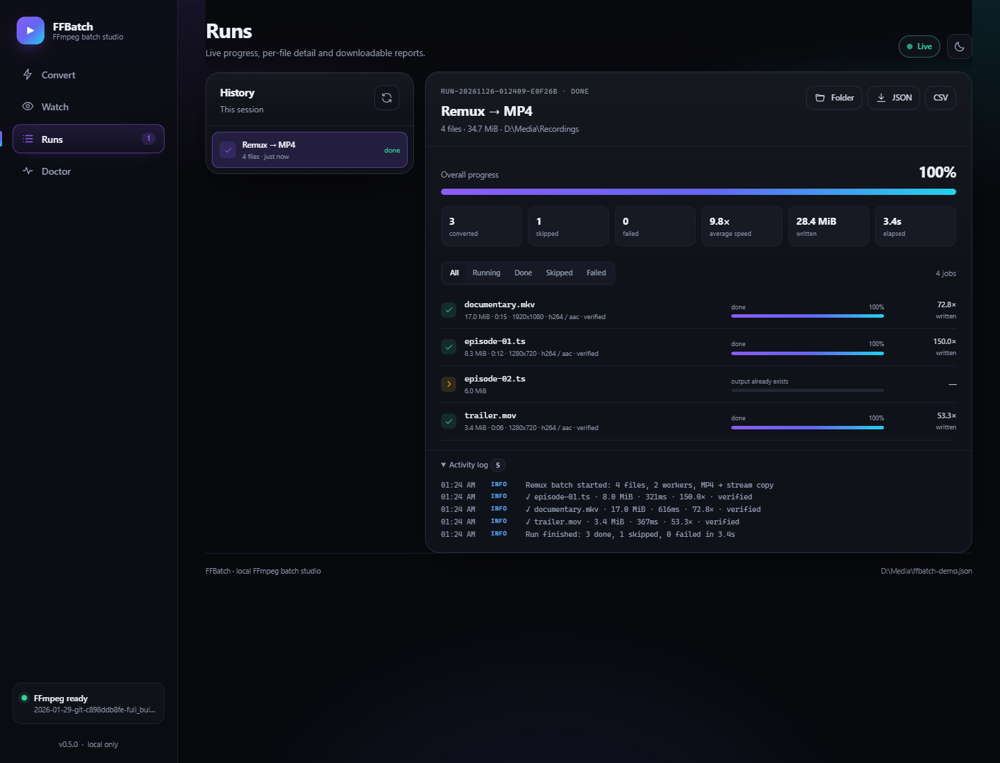

# FFBatch

[](https://github.com/Bilalmesk/ffmpeg-batch-convert/actions/workflows/ci.yml)
[](https://github.com/Bilalmesk/ffmpeg-batch-convert/actions/workflows/release.yml)

**A local FFmpeg batch studio for Windows, macOS and Linux.** One Go binary, two front ends: a polished command line and a live web dashboard. Scan a folder, preview exactly what will be converted, then watch every file move through a safe, parallel pipeline.


## Why this exists

The original project was a set of Windows `.bat` files that looped over a folder with `ffmpeg`. They worked, but they were all-or-nothing: no preview, no progress, no error reporting, no collision handling and no protection against half-written files.

FFBatch keeps the useful part — FFmpeg — and wraps it in a proper tool:

- **CLI and GUI** for the same engine.
- **Watch folders**: drop a file into a folder and FFBatch converts it after it stops growing.
- **Live per-file progress**, speed and ETA over Server-Sent Events.
- **Safe writes**: every output is written to a temporary file and only renamed into place after FFmpeg exits successfully.
- **Parallel workers**, cancellation, retry of failed jobs, skip/number/replace/fail collision policies.
- **Trim and track selection**: cut at in/out points, pick the first audio track or all tracks in a preferred language.
- **Stream-aware planning**: picks the real video stream (not cover art), converts text subtitles to `mov_text` for MP4, skips bitmap subtitles with a warning, and falls back to AAC when copied audio would not play.
- **Reports** in JSON and CSV, optional text logs.
- **A Doctor** that checks FFmpeg, encoders, configuration and write access.
- **Zero runtime dependencies** other than FFmpeg and FFprobe. The dashboard is embedded in the binary with `go:embed`; no Node.js, no browser download, no telemetry.

## Screens

| Runs with live progress | Environment checks |
| --- | --- |
|  |  |


## Requirements

- [FFmpeg](https://ffmpeg.org/) **and** `ffprobe` on `PATH` (both ship in every normal FFmpeg build).
- Go **1.24+** only if you build from source.
- Windows 10/11, macOS 12+, or a modern Linux distribution.

Install FFmpeg on Windows:

```powershell
winget install Gyan.FFmpeg
```

## Install

### Build from source

```powershell
git clone https://github.com/Bilalmesk/ffmpeg-batch-convert.git
cd ffmpeg-batch-convert
.\scripts\build.ps1
# binary: .\dist\ffbatch.exe
```

On macOS/Linux:

```bash
make build          # dist/ffbatch
# or: go build -o ffbatch .
```

### go install

```bash
go install github.com/Bilalmesk/ffmpeg-batch-convert@latest
```

### First run

```powershell
ffbatch doctor          # verify FFmpeg, encoders and folders
ffbatch serve --open    # start the dashboard
```

The dashboard binds to `127.0.0.1` by default and exits with `Ctrl+C`.

## Quick start with the dashboard

1. **Browse** to the folder that holds your recordings.
2. **Scan** to preview the files. Every file has a checkbox; deselect anything you do not want.
3. Pick a **recipe** or configure the mode yourself:
   - Remux to MP4 — stream copy, lossless and fast
   - TS seeking fix — remux with regenerated timestamps and faststart
   - Re-encode — H.264, CRF 22, universal playback
   - HEVC — H.265 for smaller archives
   - MP4 → TS — extension-only rename
4. Choose where outputs go and what happens on collisions.
5. **Start batch** and open **Runs** to follow per-file progress, cancel, retry failures, or download a report.
6. Want hands-off conversion? Open **Watch**, add a folder, and drop new recordings into it. FFBatch waits for each file to settle, then uses the current Convert settings automatically.

Settings are remembered when **Remember these settings** is checked (on by default).

## Quick start with the CLI

```powershell
# Remux every TS/MKV/MOV/... under a folder into MP4, 4 files at a time
ffbatch convert "D:\Recordings" --recursive

# Lossless remux with TS timestamp regeneration and forced 16:9
ffbatch remux "D:\Recordings\show.ts" --genpts --aspect 16:9

# Re-encode to HEVC, delete sources only after each success, write a report
ffbatch encode "D:\Recordings" --codec h265 --crf 24 --preset medium `
  --delete-source --report "D:\Reports\encode.csv"

# Extension-only rename, no media processing
ffbatch rename "D:\Shows" --to ts

# Watch a folder and convert new files as they arrive
ffbatch watch "D:\Recordings" --recursive --settle 15

# Trim, and keep only the Arabic audio track
ffbatch convert "D:\Recordings\show.ts" --trim-start 00:01:30 --trim-end 00:45:00 `
  --audio-tracks preferred --audio-lang ara

# Inspect before running
ffbatch scan "D:\Recordings" --recursive
ffbatch probe "D:\Recordings\episode.ts"
ffbatch convert "D:\Recordings" --dry-run --json
```

Flags may appear before or after paths: `ffbatch convert folder --recursive` and `ffbatch convert --recursive folder` are equivalent.

## Commands

| Command | What it does |
| --- | --- |
| `ffbatch convert` | Remux, encode or rename files/folders. The main command. |
| `ffbatch watch` | Watch folders and convert new files after they settle. |
| `ffbatch remux` | Shortcut for `convert --mode remux`. |
| `ffbatch encode` | Shortcut for `convert --mode encode`. |
| `ffbatch rename` | Shortcut for `convert --mode rename --to ts`. |
| `ffbatch scan` | List matching files, sizes and extensions. |
| `ffbatch probe` | Show container, duration, streams and size of one file. |
| `ffbatch serve` | Start the local dashboard (`--open` launches the browser). |
| `ffbatch doctor` | Check FFmpeg, encoders, config and output folder. |
| `ffbatch config` | `show`, `path`, `init`, `validate`. |
| `ffbatch version` | Build, commit, date and Go runtime. |

Run `ffbatch help <command>` for every flag.

## Modes

| Mode | Video | Audio | Use it when |
| --- | --- | --- | --- |
| `remux` | stream copy | stream copy | You only need a new container. Lossless, I/O-bound. |
| `encode` | x264/x265 | copy when compatible, otherwise AAC | You need smaller files or universal playback. |
| `rename` | untouched | untouched | You only want to change `.mp4` ↔ `.ts`. |

Scanning in `rename` mode also discovers `.mp4` files, so `ffbatch rename D:\Shows --to ts` works even though MP4 is not in the normal conversion input list.

### Smart stream handling

- The **first real video stream** is selected, with cover art/attached pictures ignored.
- **MP4 subtitles:** text tracks (`subrip`, `ass`, `mov_text`, WebVTT…) are converted to `mov_text`; bitmap tracks (PGS/VobSub/DVB) are skipped with a warning. Use MKV to keep them.
- **Encode + copy audio:** if the source audio is not MP4-friendly (Opus, Vorbis, PCM…), FFBatch automatically transcodes it to AAC and records a warning instead of producing a file that will not play.
- **Remux + incompatible audio:** the copy is left alone (remux means no re-encoding), but the job carries a warning.
- **Audio tracks:** choose all tracks, the first track, or every track matching a preferred language (`--audio-tracks preferred --audio-lang ara`). If the language is missing, FFBatch falls back to the first track and records a warning.
- **Trim:** `--trim-start` and `--trim-end` accept seconds, `MM:SS` or `HH:MM:SS`. Trimming uses output-side seeking so transport streams keep their video; stream copy starts at the first packet at or after the cut and can show a brief non-keyframe at the start. Encode mode gives a frame-accurate cut.
- `faststart` is applied only to MP4/MOV. `aspect` is metadata-only and empty by default.
- **HDR / 10-bit sources** are converted to 8-bit `yuv420p` in encode mode for maximum compatibility; HDR metadata is not preserved. Remux mode copies the original video bitstream untouched.

## Watch folders

`ffbatch watch` and the **Watch** tab turn any folder into an inbox:

1. A file appears (recorder, download, network share).
2. FFBatch waits until its size and modified time have been stable for the settle window (10 seconds by default).
3. It starts a batch using the current Convert settings. If another batch is running, the files stay queued.
4. Files that are still growing are ignored until they settle. Output folders and files already in the target format are skipped.

```powershell
ffbatch watch "D:\Recordings" --recursive --settle 15
ffbatch watch "D:\TV" "D:\Anime" --output "D:\Converted" --delete-source
```

The dashboard manages watched folders with add/pause/remove controls and an activity feed. CLI and dashboard watchers only run while FFBatch is open; watched folders are session state. Use `--existing` (CLI) or **Convert files already there** (dashboard) to process the current backlog.

## Retrying failures

When a run has failed jobs, the Runs screen shows **Retry N failed**. It starts a new run with only those inputs and the original settings, leaving successful files untouched. Fix the cause (a locked file, a missing network share, an unsupported codec), then press retry.

## Safety model

- Outputs are written as `.<name>.ffbatch-<job>.part.<ext>` next to the destination and renamed into place only on success.
- A failed or cancelled job removes its temporary file.
- `--overwrite skip` (default) leaves existing outputs alone; `number` picks `name (1).mp4`; `overwrite` replaces atomically; `fail` marks the job failed.
- Inputs are never modified unless `--delete-source` is set, and deletion only happens after a successful commit.
- An output that would overwrite its own source is refused.
- Two inputs mapping to the same output are automatically disambiguated with a numbered suffix and a warning.
- The dashboard only accepts `application/json` mutations with a same-origin check, CSP, `X-Frame-Options: DENY`, and a loopback bind by default.

## Recipes

| Recipe | Mode | Key settings |
| --- | --- | --- |
| Remux to MP4 | remux | MP4, faststart, 16:9 |
| TS seeking fix | remux | MP4, `+genpts`, faststart, 16:9 |
| Re-encode to MP4 | encode | H.264, CRF 22, `fast` |
| Re-encode to HEVC | encode | H.265, CRF 24, `medium` |
| MP4 to TS | rename | target `.ts` |

Recipes are available in the dashboard and as `--recipe <id>` on the CLI.

## Configuration

Configuration is layered:

1. `--config FILE`
2. `FFBATCH_CONFIG` environment variable
3. `./ffbatch.json` in the current folder
4. `%APPDATA%\ffbatch\ffbatch.json` (Windows) or the platform user config directory

A missing file is fine; built-in defaults are used. `ffbatch config init` writes a project-local `ffbatch.json`. The dashboard saves to whichever file is active when **Remember these settings** is checked.

See [`ffbatch.example.json`](ffbatch.example.json) for every field.

```json
{
  "mode": "remux",
  "format": "mp4",
  "outputDir": "",
  "overwrite": "skip",
  "deleteSource": false,
  "workers": 4,
  "faststart": true,
  "aspect": "",
  "genPts": true,
  "videoCodec": "h264",
  "crf": 22,
  "preset": "fast",
  "audioCodec": "copy",
  "audioBitrate": "192k",
  "audioTracks": "all",
  "audioLanguage": "",
  "subtitleCodec": "auto",
  "trimStart": "",
  "trimEnd": "",
  "extensions": ["ts", "m2ts", "mkv", "mov", "avi", "wmv", "flv", "webm", "m4v", "mpg", "mpeg"]
}
```

CLI flags always override the file. The dashboard's Advanced panel exposes workers, aspect, trim points, extensions, faststart, timestamps, source deletion, dry run and the log file. Audio track selection and the preferred language live in the Mode card because they apply to both remux and encode. Dashboard changes are sent to the running server immediately, so the Watch feature always uses the current settings.

## Reports and logs

`--report FILE.json` writes a run document with the effective config, every job, timings, output sizes, warnings and errors. `--report FILE.csv` writes one row per job. The CSV is UTF-8 with a BOM so Excel keeps non-ASCII filenames intact. The dashboard downloads the same data from the Runs screen.

`--log FILE` appends timestamped run and job lines. The dashboard keeps an in-memory activity log for each run and exposes it in the Runs screen.

## Migrating the old `.bat` files

The original scripts live in [`legacy/`](legacy/) with a mapping table. The short version:

| Old script | New |
| --- | --- |
| `convert.bat` | `ffbatch convert . --aspect 16:9` |
| `convert_all_extensions.bat` | `ffbatch convert .` |
| `convert_ts.bat` | `ffbatch convert . --genpts` |
| `convertsub.bat` | `ffbatch encode . --crf 22 --preset fast --delete-source` |
| `mp4tots.bat` | `ffbatch rename . --to ts` |
| `seeking_fix.bat` | `ffbatch convert . --genpts` |

## Performance notes

- **Remux** is disk-bound. `--workers 2` to `4` is usually optimal; more workers on one spinning disk can be slower.
- **Encode** is CPU-bound. Start with one worker per physical core, then reduce if the machine becomes unresponsive. `--preset veryfast`/`fast` gives the best quality-per-minute; `slow`/`veryslow` buy smaller files.
- **CRF**: 18 visually lossless, 20–22 high quality, 23–25 balanced, 26+ smaller. Lower is bigger and better.
- Keep sources and outputs on the same volume when possible; the final rename is then instantaneous.
- Network shares work, but `ffprobe` and `ffmpeg` add latency per file.

## Development

```
main.go        process entry point
internal/
  cli/        commands, flag parsing, rich terminal output
  config/     defaults, validation, JSON load/save, recipes
  doctor/     environment diagnostics
  engine/     scanning, planning, worker pool, events, reports
  ffmpeg/     binary discovery, argv builder, progress parser, process runner
  mediainfo/  ffprobe wrapper
  term/       ANSI styling + Windows virtual terminal
  units/      human-readable sizes and durations
  version/    build metadata
  watch/      folder polling, settle detection and queueing
  web/        HTTP API, SSE hub, embedded dashboard assets
docs/         architecture and API notes
legacy/       original batch files
```

```powershell
go test ./...
go vet ./...
go build -o dist/ffbatch.exe .
```

The UI is plain HTML/CSS/ES2020 with no build step. Assets live in `internal/web/assets/` and are embedded with `go:embed`; rebuild the binary after editing them.

More detail: [`docs/ARCHITECTURE.md`](docs/ARCHITECTURE.md) and [`docs/API.md`](docs/API.md).

### Release

Tag a commit (`v0.2.0`) and push it. GitHub Actions runs tests and GoReleaser builds Windows, macOS and Linux archives with checksums. See [`.goreleaser.yaml`](.goreleaser.yaml).

## Troubleshooting

| Problem | Fix |
| --- | --- |
| `ffmpeg was not found` | Install FFmpeg, reopen the terminal, or set `ffmpegPath` in `ffbatch.json`. `ffbatch doctor` shows the exact path. |
| MP4 conversion fails on a subtitle track | Bitmap subtitles cannot live in MP4. Choose MKV or let the default `auto` policy skip them. |
| Everything says `skipped` | Outputs already exist. Use `--overwrite number` or `--overwrite overwrite`. |
| `output would overwrite the source` | Encoding MP4 → MP4 in the same folder is refused. Choose another output folder. |
| Watch sees a file but does nothing | The file is still growing, or its extension is not in the configured list. Check the Watch activity feed for the settle timer and errors. |
| Watch output appears inside the watched folder | That is expected when the output folder is empty (next to source). Files in the target format and the configured output folder are ignored, so it will not loop. |
| Trim starts with a brief glitch | Stream copy trims at the first packet at/after the cut. Use Encode mode for a frame-accurate seek. |
| Preferred audio language is missing | FFBatch falls back to the first track and records a warning; check the language tags in `ffbatch probe`. |
| Dashboard port busy | `ffbatch serve --port 0` picks a free port. |
| Windows SmartScreen warning | The binary is unsigned. Build it yourself or use `Unblock-File` on the release archive. |
| Arabic or other Unicode names | The app is UTF-8 end-to-end. Use Windows Terminal for the best console rendering. |
| Encoder missing | Use a full FFmpeg build (gyan.dev or BtbN). Hardware encoders are not required. |

## Contributing

Pull requests are welcome. Read [CONTRIBUTING.md](CONTRIBUTING.md), follow the
[Code of Conduct](CODE_OF_CONDUCT.md), and report security issues privately as
described in [SECURITY.md](SECURITY.md).

Every pull request runs CI on **Windows and Ubuntu**: `gofmt`, `go vet`,
`go test ./...` and a full build. Pushing a `v*` tag triggers GoReleaser to build
the Windows, macOS and Linux archives and publish the GitHub release.

## License

MIT © 2026 Bilal — see [LICENSE](LICENSE).

## Author

**Bilal** · [github.com/Bilalmesk](https://github.com/Bilalmesk/)
