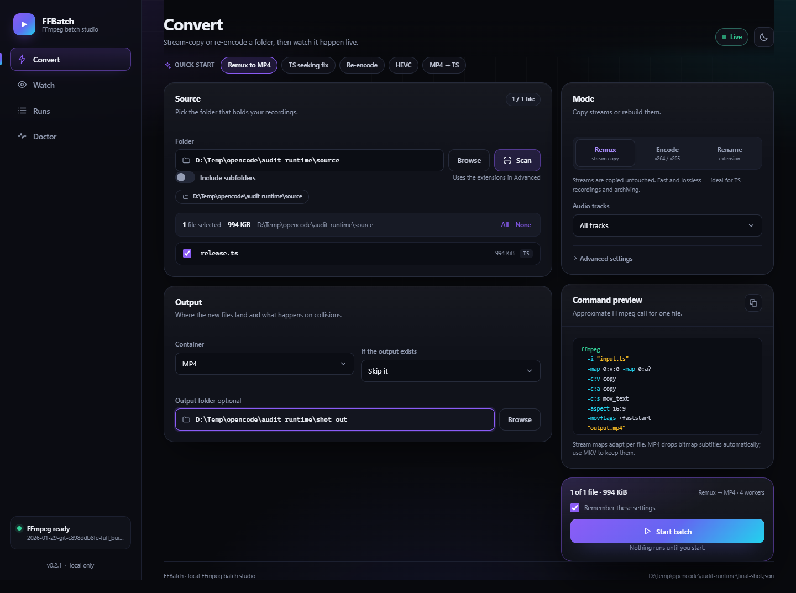
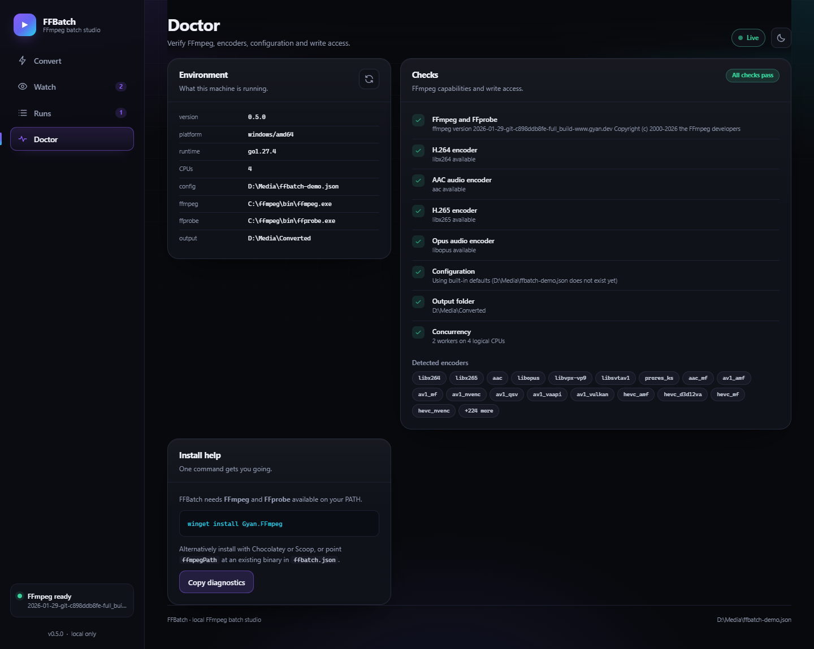
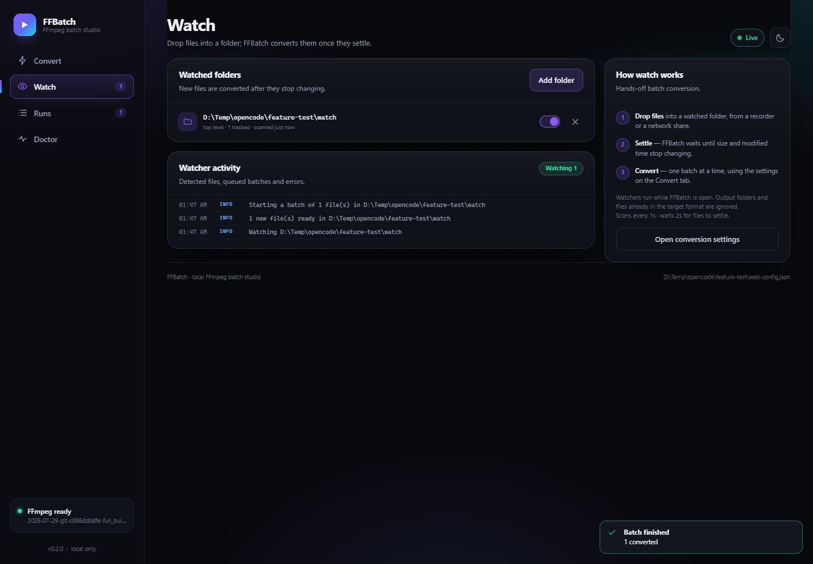

# FFBatch

[](https://github.com/Bilalmesk/ffmpeg-batch-convert/actions/workflows/ci.yml)
[](https://github.com/Bilalmesk/ffmpeg-batch-convert/actions/workflows/release.yml)

**A local FFmpeg batch studio for Windows, macOS and Linux.** One Go binary, two front ends: a polished command line and a live web dashboard. Scan a folder, preview exactly what will be converted, then watch every file move through a safe, parallel pipeline.



## Why this exists

The original project was a set of Windows `.bat` files that looped over a folder with `ffmpeg`. They worked, but they were all-or-nothing: no preview, no progress, no error reporting, no collision handling and no protection against half-written files.

FFBatch keeps the useful part — FFmpeg — and wraps it in a proper tool:

- **CLI and GUI** for the same engine.
- **Watch folders**: drop a file into a folder and FFBatch converts it after it stops growing.
- **Live per-file progress**, speed and ETA over Server-Sent Events.
- **Safe writes**: every output is written to a temporary file and only renamed into place after FFmpeg exits successfully.
- **Verified commits**: the temporary output is probed before it can replace anything — codec, resolution, duration and audio-track count must match the plan. A truncated or malformed result is rejected and the source is left alone.
- **Chain of custody**: opt-in SHA-256 hashes for sources and outputs, embedded in JSON/CSV reports, plus `ffbatch verify --manifest` to re-check a finished batch later.
- **Archive instead of delete**: move verified originals into an archive tree, with an automatic guard against changed sources and a refusal to re-watch archived files.
- **Hardened dashboard**: optional shared-secret authentication, loopback-only by default, and a refusal to expose the UI on a LAN without a token.
- **Parallel workers**, cancellation, retry of failed jobs, skip/number/replace/fail collision policies.
- **Trim and track selection**: cut at in/out points, pick the first audio track or all tracks in a preferred language.
- **Stream-aware planning**: picks the real video stream (not cover art), converts text subtitles to `mov_text` for MP4, skips bitmap subtitles with a warning, and falls back to AAC when copied audio would not play.
- **AV1, H.264 and H.265** encoding, plus MKVToolNix, MP4Box/Bento4, yt-dlp and VMAF integrations when those optional tools are installed.
- **Audio extraction** to FLAC, Opus, MP3, M4A or WAV, with optional loudness normalization.
- **Multi-step workflows** that chain probe, convert, quality gates, MKV muxing, HLS/DASH packaging, audio and copy/delete into repeatable recipes.
- **Reports** in JSON and CSV, optional text logs.
- **A Doctor** that checks FFmpeg, encoders, configuration and write access.
- **Zero runtime dependencies** other than FFmpeg and FFprobe. The dashboard is embedded in the binary with `go:embed`; no Node.js, no browser download, no telemetry.

## Screens

| Runs with live progress | Environment checks |
| --- | --- |
|  |  |



## Requirements

- [FFmpeg](https://ffmpeg.org/) **and** `ffprobe` on `PATH` (both ship in every normal FFmpeg build).
- Go **1.24+** only if you build from source.
- Windows 10/11, macOS 12+, or a modern Linux distribution.

Optional pro tools are detected automatically: MKVToolNix (`ffbatch mux`), GPAC
MP4Box or Bento4 (`ffbatch package`), yt-dlp and aria2c (`ffbatch fetch`).
`ffbatch tools` shows what is available. See [docs/TOOLCHAIN.md](docs/TOOLCHAIN.md).

Install FFmpeg on Windows:

```powershell
winget install Gyan.FFmpeg
```

## Install

### Build from source

```powershell
git clone https://github.com/Bilalmesk/ffmpeg-batch-convert.git
cd ffmpeg-batch-convert
.\scripts\build.ps1
# binary: .\dist\ffbatch.exe
```

On macOS/Linux:

```bash
make build          # dist/ffbatch
# or: go build -o ffbatch .
```

### go install

```bash
go install github.com/Bilalmesk/ffmpeg-batch-convert/cmd/ffbatch@latest
```

This installs a binary named `ffbatch` (the release archives and build scripts
use the same name).

### First run

```powershell
ffbatch doctor          # verify FFmpeg, encoders and folders
ffbatch serve --open    # start the dashboard
```

The dashboard binds to `127.0.0.1` by default and exits with `Ctrl+C`. To use it
from another machine, set a token first:

```powershell
$env:FFBATCH_TOKEN = "a-long-random-secret"
ffbatch serve --host 0.0.0.0 --open
```

## Quick start with the dashboard

1. **Browse** to the folder that holds your recordings.
2. **Scan** to preview the files. Every file has a checkbox; deselect anything you do not want.
3. Pick a **recipe** or configure the mode yourself:
   - Remux to MP4 — stream copy, lossless and fast
   - TS seeking fix — remux with regenerated timestamps and faststart
   - Re-encode — H.264, CRF 22, universal playback
   - HEVC — H.265 for smaller archives
   - MP4 → TS — extension-only rename
4. Choose where outputs go and what happens on collisions.
5. **Start batch** and open **Runs** to follow per-file progress, cancel, retry failures, or download a report.
6. Want hands-off conversion? Open **Watch**, add a folder, and drop new recordings into it. FFBatch waits for each file to settle, then uses the current Convert settings automatically.

Settings are remembered when **Remember these settings** is checked (on by default).

## Quick start with the CLI

```powershell
# Remux every TS/MKV/MOV/... under a folder into MP4, 4 files at a time
ffbatch convert "D:\Recordings" --recursive

# Lossless remux with TS timestamp regeneration and forced 16:9
ffbatch remux "D:\Recordings\show.ts" --genpts --aspect 16:9

# Re-encode to HEVC, delete sources only after each success, write a report
ffbatch encode "D:\Recordings" --codec h265 --crf 24 --preset medium `
  --delete-source --report "D:\Reports\encode.csv"

# Keep the originals: move each verified source into an archive tree
ffbatch convert "D:\Recordings" --archive "D:\Archive" --hash-files `
  --report "D:\Reports\convert.json"

# Re-check a finished batch later (size + SHA-256 + source integrity)
ffbatch verify --manifest "D:\Reports\convert.json"

# AV1 encode through the same verified pipeline
ffbatch encode "D:\Recordings\show.mkv" --codec av1 --crf 30 --preset medium

# Professional MKV muxing: keep tracks, chapters, tags and attachments
ffbatch mux "D:\recording.ts" --output "D:\recording.mkv" --chapters chapters.xml

# Package for streaming
ffbatch package "D:\movie.mp4" --out "D:\Web\movie" --format hls

# Quality gate a candidate encode against the source
ffbatch quality --reference "D:\source.mp4" --candidate "D:\encode.mp4" --min 93

# Download, then let Watch convert it
ffbatch fetch "https://example.com/video" --output "D:\Incoming"

# Extract audio to FLAC/Opus/MP3/M4A/WAV
ffbatch audio "D:\Recordings" --recursive --format flac --output "D:\Audio"

# Chain multiple tools into one workflow
ffbatch workflow run multi-delivery --input "D:\master.mov" --output "D:\Delivery"

# Extension-only rename, no media processing
ffbatch rename "D:\Shows" --to ts

# Watch a folder and convert new files as they arrive
ffbatch watch "D:\Recordings" --recursive --settle 15

# Trim, and keep only the Arabic audio track
ffbatch convert "D:\Recordings\show.ts" --trim-start 00:01:30 --trim-end 00:45:00 `
  --audio-tracks preferred --audio-lang ara

# Inspect before running
ffbatch scan "D:\Recordings" --recursive
ffbatch probe "D:\Recordings\episode.ts"
ffbatch convert "D:\Recordings" --dry-run --json
```

Flags may appear before or after paths: `ffbatch convert folder --recursive` and `ffbatch convert --recursive folder` are equivalent.

## Commands

| Command | What it does |
| --- | --- |
| `ffbatch convert` | Remux, encode or rename files/folders. The main command. |
| `ffbatch watch` | Watch folders and convert new files after they settle. |
| `ffbatch remux` | Shortcut for `convert --mode remux`. |
| `ffbatch encode` | Shortcut for `convert --mode encode`. |
| `ffbatch rename` | Shortcut for `convert --mode rename --to ts`. |
| `ffbatch scan` | List matching files, sizes and extensions. |
| `ffbatch probe` | Show container, duration, streams and size of one file. |
| `ffbatch serve` | Start the local dashboard (`--open` launches the browser). |
| `ffbatch doctor` | Check FFmpeg, encoders, config and output folder. |
| `ffbatch verify` | Verify outputs against a JSON report or probe files. |
| `ffbatch tools` | Detect optional muxing, packaging, ingest and quality tools. |
| `ffbatch quality` | Compare a candidate encode with a reference (VMAF/SSIM/PSNR). |
| `ffbatch mux` | Mux MKV tracks, chapters and tags with MKVToolNix. |
| `ffbatch package` | Package HLS or DASH with FFmpeg, MP4Box or Bento4. |
| `ffbatch fetch` | Download media with yt-dlp. |
| `ffbatch audio` | Extract or convert audio to FLAC/Opus/MP3/M4A/WAV. |
| `ffbatch workflow` | Run multi-step probe/convert/quality/mux/package recipes. |
| `ffbatch config` | `show`, `path`, `init`, `validate`. |
| `ffbatch version` | Build, commit, date and Go runtime. |

Run `ffbatch help <command>` for every flag.

## Modes

| Mode | Video | Audio | Use it when |
| --- | --- | --- | --- |
| `remux` | stream copy | stream copy | You only need a new container. Lossless, I/O-bound. |
| `encode` | x264/x265/AV1 | copy when compatible, otherwise AAC | You need smaller files or universal playback. |
| `rename` | untouched | untouched | You only want to change `.mp4` ↔ `.ts`. |

Scanning in `rename` mode also discovers `.mp4` files, so `ffbatch rename D:\Shows --to ts` works even though MP4 is not in the normal conversion input list.

### Smart stream handling

- The **first real video stream** is selected, with cover art/attached pictures ignored.
- **MP4 subtitles:** text tracks (`subrip`, `ass`, `mov_text`, WebVTT…) are converted to `mov_text`; bitmap tracks (PGS/VobSub/DVB) are skipped with a warning. Use MKV to keep them.
- **Encode + copy audio:** if the source audio is not MP4-friendly (Opus, Vorbis, PCM…), FFBatch automatically transcodes it to AAC and records a warning instead of producing a file that will not play.
- **Remux + incompatible audio:** the copy is left alone (remux means no re-encoding), but the job carries a warning.
- **Audio tracks:** choose all tracks, the first track, or every track matching a preferred language (`--audio-tracks preferred --audio-lang ara`). If the language is missing, FFBatch falls back to the first track and records a warning.
- **Trim:** `--trim-start` and `--trim-end` accept seconds, `MM:SS` or `HH:MM:SS`. Trimming uses output-side seeking so transport streams keep their video; stream copy starts at the first packet at or after the cut and can show a brief non-keyframe at the start. Encode mode gives a frame-accurate cut.
- `faststart` is applied only to MP4/MOV. `aspect` is metadata-only and empty by default.
- **HDR / 10-bit sources** are converted to 8-bit `yuv420p` in encode mode for maximum compatibility; HDR metadata is not preserved. Remux mode copies the original video bitstream untouched.

## Watch folders

`ffbatch watch` and the **Watch** tab turn any folder into an inbox:

1. A file appears (recorder, download, network share).
2. FFBatch waits until its size and modified time have been stable for the settle window (10 seconds by default).
3. It starts a batch using the current Convert settings. If another batch is running, the files stay queued.
4. Files that are still growing are ignored until they settle. Output folders, archive folders, and files already in the target format are skipped.

```powershell
ffbatch watch "D:\Recordings" --recursive --settle 15
ffbatch watch "D:\TV" "D:\Anime" --output "D:\Converted" --delete-source
```

The dashboard manages watched folders with add/pause/remove controls and an activity feed. CLI and dashboard watchers only run while FFBatch is open; watched folders are session state. Use `--existing` (CLI) or **Convert files already there** (dashboard) to process the current backlog.

## Retrying failures

When a run has failed jobs, the Runs screen shows **Retry N failed**. It starts a new run with only those inputs and the original settings, leaving successful files untouched. Fix the cause (a locked file, a missing network share, an unsupported codec), then press retry.

## Safety model

- Outputs are written as `.<name>.ffbatch-<job>.part.<ext>` next to the destination and renamed into place only on success.
- **Verification is on by default.** Before the rename, FFBatch probes the temporary file and checks the video codec, resolution, duration (with a small container tolerance), and the expected audio-track count. A mismatch removes the temporary file and fails the job, so a bad output never replaces a good source. Disable it with `--verify-output=false` or `"verifyOutput": false`.
- A failed or cancelled job removes its temporary file.
- **Disk-space preflight** estimates the output size and refuses to start when the destination volume is too full, instead of filling the disk with a partial file.
- `--overwrite skip` (default) leaves existing outputs alone; `number` picks `name (1).mp4`; `overwrite` replaces atomically; `fail` marks the job failed.
- Inputs are never modified unless `--delete-source` or `--archive` is set, and only after a verified commit. The source's size and modification time are re-checked first; if it changed during conversion it is left in place.
- `--archive DIR` moves the original into `DIR`, preserving its path relative to the scanned root. It cannot be combined with `--delete-source`, is refused in rename mode, and the watcher ignores the archive tree so archived files are never converted again.
- An output that would overwrite its own source is refused.
- Two inputs mapping to the same output are automatically disambiguated with a numbered suffix and a warning.
- The dashboard only accepts `application/json` mutations with a same-origin check, CSP, `X-Frame-Options: DENY`, and a loopback bind by default. A non-loopback bind requires `--token` (or `FFBATCH_TOKEN`) unless `--insecure` is passed explicitly.
- When a token is set, `?token=SECRET` on the first visit sets an HttpOnly, SameSite=Strict cookie and redirects to `/`. API clients can send `Authorization: Bearer SECRET` or `X-FFBatch-Token: SECRET`. The dashboard speaks HTTP, not HTTPS: use a VPN, SSH tunnel or trusted network for sensitive material.
- GitHub release archives carry SHA-256 checksums, a signed build-provenance attestation and an SPDX SBOM. CI runs CodeQL and `govulncheck`.
- `ffbatch mux` writes to a temporary `.part` file and renames it only after MKVToolNix succeeds. `ffbatch package` writes a directory of manifests/segments; review them before publishing. `ffbatch quality` is read-only.

## Trusted pipeline

For recordings you cannot easily recreate — interviews, evidence, family archives — turn on the full chain:

```powershell
ffbatch convert "D:\Evidence\case-042" `
  --output "D:\Derived\case-042" `
  --archive "D:\Originals\case-042" `
  --hash-files --report "D:\Reports\case-042.json"
```

What happens:

1. The source is hashed (forced automatically whenever a source is archived or deleted).
2. FFmpeg writes a temporary output.
3. The output is probed and compared with the source plan.
4. The output is hashed and atomically committed.
5. The source is re-checked, then moved to the archive tree.
6. The JSON report records both hashes, the verification result, the archive destination and every warning.

Months later, `ffbatch verify --manifest D:\Reports\case-042.json` re-hashes every output and the archived originals. A changed size or hash returns exit code 1 and names the affected file. The same data is available as CSV for spreadsheets.

## Pro toolchain

FFBatch stays a single binary and still needs only FFmpeg. When other tools are
installed, it can delegate specialist work to them:

```powershell
ffbatch tools                  # what is installed, versions and hints
ffbatch tools --missing        # only what is absent
```

| Command | Optional tool | Use it for |
| --- | --- | --- |
| `ffbatch mux` | MKVToolNix `mkvmerge` | Keep every MKV track, chapter, tag and attachment without re-encoding |
| `ffbatch package` | FFmpeg (always), MP4Box, Bento4 | HLS and DASH output for web/streaming |
| `ffbatch fetch` | yt-dlp, aria2c | Download from sites and playlists before converting |
| `ffbatch quality` | FFmpeg `libvmaf`, `ssim`, `psnr` | Prove that an encode still matches the source |

### AV1 encoding

`--codec av1` routes through the existing verification and reporting pipeline:

```powershell
ffbatch encode "D:\Shows" --codec av1 --av1-encoder svt --crf 30 --preset medium `
  --output "D:\AV1" --report "D:\Reports\av1.json"
```

- `svt` (libsvtav1) is the default and fastest.
- `aom` (libaom-av1) is the reference encoder, slower.
- `rav1e` uses the Rust encoder.
- Preset names are mapped to each encoder's own speed scale.
- AV1 CRF is 0–63; the dashboard slider expands to 63 when AV1 is selected.
- Verification expects `av1`, and `ffbatch quality` can measure the result.

### Quality gates

```powershell
ffbatch quality --reference source.mp4 --candidate encoded.mp4 --min 93
ffbatch quality --reference source.mp4 --candidate encoded.mp4 --metric ssim --json
```

VMAF needs an FFmpeg build with `libvmaf`. SSIM and PSNR are built into normal
FFmpeg builds. Both files are probed, the candidate is scaled to the reference
resolution, and only the shorter duration is compared. Exit code `1` when the
score is below `--min`, which makes it usable in a publishing script.

### MKV muxing

```powershell
ffbatch mux recording.ts --output recording.mkv `
  --title "Interview" --chapters chapters.xml --languages 0:ara,1:eng
```

MKVToolNix is better than a generic remux for MKV-specific features: chapters,
tags, attachments, track names and languages. `--dry-run` prints the command.

### HLS and DASH

```powershell
ffbatch package movie.mp4 --out D:\Web\movie --format hls --segment 6
ffbatch package movie.mp4 --out D:\Web\movie --format dash --tool mp4box
```

The default FFmpeg backend stream-copies the first video and all audio tracks.
Use `--tool mp4box` or `--tool bento4` when those tools are installed. Package
after converting to a delivery codec if the source is not HLS/DASH-friendly.

### Downloading

```powershell
ffbatch fetch "https://example.com/video" --output "D:\Incoming"
ffbatch fetch "https://example.com/playlist" --output "D:\Incoming" --playlist
ffbatch fetch "https://example.com/audio" --output "D:\Music" --audio-only --audio-format opus
```

A download archive in the output folder skips items that were already fetched.
Use `--downloader aria2c` for large files.

### Audio extraction

```powershell
ffbatch audio "D:\Recordings" --recursive --format flac --output "D:\Audio"
ffbatch audio interview.mkv --format opus --bitrate 96k --normalize
ffbatch audio song.mp4 --format mp3 --json
```

Audio mode drops video, extracts one track (`--track`), verifies the output with
`ffprobe`, and moves it into place atomically. FLAC/WAV are lossless; Opus is
efficient for speech; MP3/M4A are broadly compatible. `--normalize` applies EBU
R128 loudness normalization through FFmpeg. SoX remains a detected companion
for effects that go beyond normalization.

### What is not integrated

The ecosystem is bigger than one binary. **libav** is the historical FFmpeg fork
and not a second engine. **GStreamer** is for live graphs and capture, **MLT** is
for timeline editing, and **PyAV/MoviePy/OpenCV/fluent-ffmpeg/ffmpeg.wasm** are
language-specific libraries. They are excellent at their jobs, but adding them
to a Go batch converter would duplicate FFmpeg, bloat the binary and weaken the
single-binary model. [docs/TOOLCHAIN.md](docs/TOOLCHAIN.md) explains each choice
and the roadmap (ab-av1 tuning, audio mode, Av1an, VapourSynth presets).

## Workflows

Some media problems need more than one tool: decode/repair, encode twice, measure quality, mux, package, extract audio, then copy or archive. Workflows make that repeatable without a shell script.

```powershell
ffbatch workflow list
ffbatch workflow run ts-repair --input "D:\recording.ts" --output "D:\Fixed"
ffbatch workflow run multi-delivery --input "D:\master.mov" --output "D:\Delivery"
```

| Workflow | Chain |
| --- | --- |
| `ts-repair` | probe → remux with genpts → verify → SHA-256 |
| `av1-quality` | probe → AV1 encode → VMAF ≥90 → copy |
| `mkv-preserve` | probe → MKVToolNix mux (tracks/chapters/tags) |
| `hls-delivery` | probe → H.264/AAC mezzanine → HLS |
| `dash-delivery` | probe → H.264/AAC mezzanine → DASH |
| `audio-delivery` | probe → FLAC + loudness normalization |
| `multi-delivery` | H.264 MP4 + AV1 + VMAF gate + FLAC |

`ffbatch workflow init multi-delivery` writes an editable JSON file. Steps are typed (`probe`, `convert`, `quality`, `mux`, `package`, `audio`, `copy`, `delete`), can be conditional, can retry, and use templates such as `{{input}}`, `{{base}}`, `{{work}}`, `{{outputDir}}`, `{{steps.encode.output}}` and `{{steps.quality.score}}`. No shell is involved.

The full schema, conditions, parameters and safety rules are in [`docs/WORKFLOWS.md`](docs/WORKFLOWS.md).

## Recipes

| Recipe | Mode | Key settings |
| --- | --- | --- |
| Remux to MP4 | remux | MP4, faststart, 16:9 |
| TS seeking fix | remux | MP4, `+genpts`, faststart, 16:9 |
| Re-encode to MP4 | encode | H.264, CRF 22, `fast` |
| Re-encode to HEVC | encode | H.265, CRF 24, `medium` |
| Re-encode to AV1 | encode | AV1/SVT-AV1, CRF 30, `medium` |
| MP4 to TS | rename | target `.ts` |

Recipes are available in the dashboard and as `--recipe <id>` on the CLI.

## Configuration

Configuration is layered:

1. `--config FILE`
2. `FFBATCH_CONFIG` environment variable
3. `./ffbatch.json` in the current folder
4. `%APPDATA%\ffbatch\ffbatch.json` (Windows) or the platform user config directory

A missing file is fine; built-in defaults are used. `ffbatch config init` writes a project-local `ffbatch.json`. The dashboard saves to whichever file is active when **Remember these settings** is checked.

See [`ffbatch.example.json`](ffbatch.example.json) for every field.

```json
{
  "mode": "remux",
  "format": "mp4",
  "outputDir": "",
  "overwrite": "skip",
  "deleteSource": false,
  "archiveDir": "",
  "verifyOutput": true,
  "hashFiles": false,
  "workers": 4,
  "faststart": true,
  "aspect": "",
  "genPts": true,
  "videoCodec": "h264",
  "av1Encoder": "svt",
  "crf": 22,
  "preset": "fast",
  "audioCodec": "copy",
  "audioBitrate": "192k",
  "audioTracks": "all",
  "audioLanguage": "",
  "subtitleCodec": "auto",
  "trimStart": "",
  "trimEnd": "",
  "extensions": ["ts", "m2ts", "mkv", "mov", "avi", "wmv", "flv", "webm", "m4v", "mpg", "mpeg"],
  "tools": {}
}
```

CLI flags always override the file. The dashboard's Output card exposes the archive folder, while the Advanced panel adds workers, aspect, trim points, extensions, faststart, timestamps, output verification, SHA-256 hashing, source deletion, dry run and the log file. Audio track selection and the preferred language live in the Mode card because they apply to both remux and encode. The AV1 encoder selector appears when AV1 is chosen. Dashboard changes are sent to the running server immediately, so the Watch feature always uses the current settings.

## Reports and logs

`--report FILE.json` writes a run document with the manifest schema, FFBatch version, effective config, every job, timings, output sizes, verification results, SHA-256 hashes, warnings and errors. `--report FILE.csv` writes one row per job. The CSV is UTF-8 with a BOM so Excel keeps non-ASCII filenames intact. The dashboard downloads the same data from the Runs screen.

The JSON report doubles as a **manifest**:

```powershell
ffbatch verify --manifest "D:\Reports\encode.json"          # table
ffbatch verify --manifest "D:\Reports\encode.json" --json   # machine-readable
```

Every completed job is checked for existence, exact size and SHA-256. When a source hash is present it is verified too: at the original path if it still exists, at the recorded archive path if it was archived, or reported as removed if it was deleted. Exit code is 1 on any failure, so it can gate a backup or publishing step.

`--log FILE` appends timestamped run and job lines. The dashboard keeps an in-memory activity log for each run and exposes it in the Runs screen.

## Migrating the old `.bat` files

The original scripts live in [`legacy/`](legacy/) with a mapping table. The short version:

| Old script | New |
| --- | --- |
| `convert.bat` | `ffbatch convert . --aspect 16:9` |
| `convert_all_extensions.bat` | `ffbatch convert .` |
| `convert_ts.bat` | `ffbatch convert . --genpts` |
| `convertsub.bat` | `ffbatch encode . --crf 22 --preset fast --delete-source` |
| `mp4tots.bat` | `ffbatch rename . --to ts` |
| `seeking_fix.bat` | `ffbatch convert . --genpts` |

## Performance notes

- **Remux** is disk-bound. `--workers 2` to `4` is usually optimal; more workers on one spinning disk can be slower.
- **Encode** is CPU-bound. Start with one worker per physical core, then reduce if the machine becomes unresponsive. `--preset veryfast`/`fast` gives the best quality-per-minute; `slow`/`veryslow` buy smaller files.
- **CRF**: 18 visually lossless, 20–22 high quality, 23–25 balanced, 26+ smaller. Lower is bigger and better.
- **AV1**: `--av1-encoder svt` is the practical batch choice. `aom` is much slower, and `rav1e` sits between them. AV1 CRF uses a 0–63 scale and is not directly comparable to x264/x265 CRF.
- Use `ffbatch quality` after a trial encode to verify that the chosen CRF still meets your quality bar.
- Keep sources and outputs on the same volume when possible; the final rename is then instantaneous.
- `--hash-files` adds one full read of every source and output. It is forced for `--archive`/`--delete-source`, where the audit trail matters more than the extra I/O.
- Network shares work, but `ffprobe` and `ffmpeg` add latency per file.

## Development

```
main.go        release/build entry point
cmd/ffbatch/   go-install entry point (thin wrapper over internal/cli)
internal/
  cli/        commands, flag parsing, rich terminal output
  config/     defaults, validation, JSON load/save, recipes
  audio/      audio-only extraction command construction
  disk/       free-space probes (Windows + Unix)
  doctor/     environment diagnostics
  engine/     scanning, planning, worker pool, verification, reports
  ffmpeg/     binary discovery, argv builder, progress parser, process runner
  hashutil/   streaming SHA-256 for chain-of-custody reports
  mediainfo/  ffprobe wrapper
  muxer/      MKVToolNix command construction
  packager/   HLS/DASH plans for FFmpeg, MP4Box and Bento4
  quality/    VMAF, SSIM and PSNR measurement
  toolchain/  optional tool detection, versions and hints
  workflow/   typed multi-step pipelines, conditions and built-in recipes
  term/       ANSI styling + Windows virtual terminal
  units/      human-readable sizes and durations
  version/    build metadata
  watch/      folder polling, settle detection and queueing
  web/        HTTP API, SSE hub, embedded dashboard assets
  ytdlp/      yt-dlp argv construction
docs/         architecture and API notes
legacy/       original batch files
```

```powershell
go test ./...
go vet ./...
go build -o dist/ffbatch.exe .
```

The UI is plain HTML/CSS/ES2020 with no build step. Assets live in `internal/web/assets/` and are embedded with `go:embed`; rebuild the binary after editing them.

More detail: [`docs/ARCHITECTURE.md`](docs/ARCHITECTURE.md), [`docs/API.md`](docs/API.md), [`docs/TOOLCHAIN.md`](docs/TOOLCHAIN.md) and [`docs/WORKFLOWS.md`](docs/WORKFLOWS.md).

### Release

Tag a commit (`v0.5.0`) and push it. GitHub Actions runs tests and GoReleaser builds Windows, macOS and Linux archives with checksums. It then generates an SPDX SBOM and signed build-provenance/SBOM attestations for the archives. See [`.goreleaser.yaml`](.goreleaser.yaml).

## Troubleshooting

| Problem | Fix |
| --- | --- |
| `ffmpeg was not found` | Install FFmpeg, reopen the terminal, or set `ffmpegPath` in `ffbatch.json`. `ffbatch doctor` shows the exact path. |
| MP4 conversion fails on a subtitle track | Bitmap subtitles cannot live in MP4. Choose MKV or let the default `auto` policy skip them. |
| Everything says `skipped` | Outputs already exist. Use `--overwrite number` or `--overwrite overwrite`. |
| `output would overwrite the source` | Encoding MP4 → MP4 in the same folder is refused. Choose another output folder. |
| Watch sees a file but does nothing | The file is still growing, or its extension is not in the configured list. Check the Watch activity feed for the settle timer and errors. |
| Watch output appears inside the watched folder | That is expected when the output folder is empty (next to source). Files in the target format and the configured output folder are ignored, so it will not loop. |
| Trim starts with a brief glitch | Stream copy trims at the first packet at/after the cut. Use Encode mode for a frame-accurate seek. |
| Preferred audio language is missing | FFBatch falls back to the first track and records a warning; check the language tags in `ffbatch probe`. |
| Dashboard port busy | `ffbatch serve --port 0` picks a free port. |
| `401 Unauthorized` in the dashboard | A token is configured. Open the printed URL with `?token=SECRET` once, or pass the token as `Authorization: Bearer`/`X-FFBatch-Token`. |
| `refusing to expose the dashboard` | Set `FFBATCH_TOKEN` (16+ characters) or pass `--token`; `--insecure` explicitly allows an unauthenticated LAN bind. |
| Verification failed after a conversion | The output was truncated or structurally wrong. The temporary file was removed and the source was left untouched; check free space, the FFmpeg log and `ffbatch probe` on the source. |
| `not enough free space` | The destination volume cannot hold the estimated output. Free space, choose another output folder, or convert fewer files at once. |
| Archived files keep appearing in Watch | Upgrade to 0.3.0; the watcher now ignores the archive folder. |
| `libvmaf` not found | Use an FFmpeg build with libvmaf, or run `ffbatch quality --metric ssim`/`psnr`. |
| `mkvmerge was not found` | Install MKVToolNix, or set `tools.mkvmerge` in `ffbatch.json`. |
| `MP4Box is not installed` | Use `--tool ffmpeg` for HLS/DASH, or install GPAC/Bento4. |
| HLS/DASH player shows nothing | The source codecs may not be delivery-friendly. Encode to H.264/AAC first, then package. |
| yt-dlp download skips a video | It is already in the folder's `.ffbatch-download-archive.txt`; use `--no-archive` or remove the entry. |
| Windows SmartScreen warning | The binary is unsigned. Build it yourself or use `Unblock-File` on the release archive. |
| Arabic or other Unicode names | The app is UTF-8 end-to-end. Use Windows Terminal for the best console rendering. |
| Encoder missing | Use a full FFmpeg build (gyan.dev or BtbN). AV1 needs libsvtav1, libaom-av1 or librav1e. Hardware encoders are not required. |

## Contributing

Pull requests are welcome. Read [CONTRIBUTING.md](CONTRIBUTING.md), follow the
[Code of Conduct](CODE_OF_CONDUCT.md), and report security issues privately as
described in [SECURITY.md](SECURITY.md).

Every pull request runs CI on **Windows and Ubuntu**: `gofmt`, `go vet`,
`go test ./...`, a full build, `govulncheck`, and an end-to-end FFmpeg smoke
conversion that also exercises hashing, verification and tamper rejection on
Ubuntu. Tests cover AV1 argv planning, audio extraction, MKV muxing, HLS/DASH
packaging, quality metrics, yt-dlp argument construction and multi-step workflow
execution. CodeQL analyzes the Go code on every push and pull request. Pushing a `v*` tag runs the same CI matrix before
GoReleaser builds the Windows, macOS and Linux archives and publishes the GitHub
release.

## License

MIT © 2026 Bilal — see [LICENSE](LICENSE).

## Author

**Bilal** · [github.com/Bilalmesk](https://github.com/Bilalmesk/)
